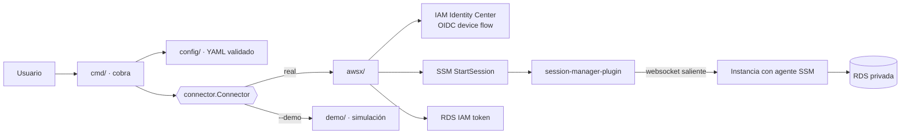
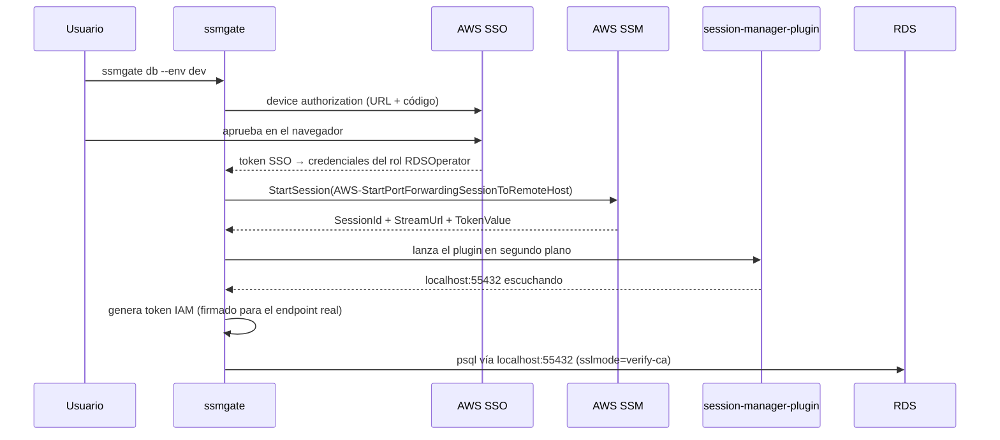

# ssmgate

[](https://github.com/dapasa/ssmgate/actions/workflows/ci.yml)
[](https://github.com/dapasa/ssmgate/releases)

**Acceso seguro a servidores y bases de datos privadas de AWS a través de SSM
Session Manager: sin SSH, sin puertos abiertos y sin claves de bastion.**

`ssmgate` es una CLI multiplataforma escrita en Go (un único binario estático)
que cualquier equipo que use AWS puede configurar con un archivo YAML para:

- abrir una **shell interactiva** en cualquier instancia gestionada por SSM;
- abrir un **túnel a una base de datos privada** (RDS/Aurora PostgreSQL) y
  conectarse con `psql` usando un **token IAM de 15 minutos** en lugar de una
  contraseña;
- mantener ese túnel abierto para usar **tu propio cliente** (DBeaver,
  TablePlus, herramientas de migraciones…).

> **Trabajo Fin de Máster** — Máster en Programación con IA.

| Recurso | Enlace |
|---|---|
| Repositorio | https://github.com/dapasa/ssmgate |
| Publicación (binarios descargables) | https://github.com/dapasa/ssmgate/releases |
| Presentación (slides) | [docs/slides/ssmgate-tfm.pdf](docs/slides/ssmgate-tfm.pdf) |
| Vídeo de la explicación | _TODO: añadir URL_ |
| Usuario y contraseña de prueba | **No aplica**: no hay login propio. Para probarlo sin cuenta de AWS se usa el **modo demo** (`--demo`). |

---

## Índice

1. [Descripción general](#1-descripción-general)
2. [Stack tecnológico](#2-stack-tecnológico)
3. [Instalación y ejecución](#3-instalación-y-ejecución)
4. [Probarlo en 1 minuto: modo demo](#4-probarlo-en-1-minuto-modo-demo)
5. [Configuración](#5-configuración)
6. [Funcionalidades principales](#6-funcionalidades-principales)
7. [Estructura del proyecto](#7-estructura-del-proyecto)
8. [Arquitectura](#8-arquitectura)
9. [Calidad: tests, lint y CI/CD](#9-calidad-tests-lint-y-cicd)
10. [Despliegue / publicación](#10-despliegue--publicación)
11. [Desarrollo asistido por IA](#11-desarrollo-asistido-por-ia)
12. [Decisiones técnicas](#12-decisiones-técnicas)
13. [Licencia](#13-licencia)

---

## 1. Descripción general

### El problema

Acceder a recursos privados de AWS (una base de datos en una subred privada o
un servidor interno) suele resolverse con un **bastion SSH**: un servidor con
el puerto 22 abierto, claves SSH repartidas entre el equipo y poca trazabilidad
de quién hizo qué. Es una superficie de ataque y un problema de auditoría
(SOC 2, ISO 27001…).

AWS ofrece una alternativa mejor, **Systems Manager Session Manager**: el
agente SSM de la instancia abre una conexión *saliente* hacia AWS, así que no
hace falta ningún puerto de entrada, y cada sesión queda autenticada con IAM y
registrada. El problema es que usarlo a mano es engorroso: login SSO,
elegir cuenta y rol, buscar el ID de la instancia, montar el túnel con el
documento correcto, generar el token IAM de RDS, configurar SSL...

### La solución

`ssmgate` reduce todo eso a un comando:

```bash
ssmgate db --env dev          # login SSO → túnel → token IAM → psql
```

Todo lo específico de cada organización (portal SSO, cuentas, instancias,
roles y bases de datos) vive en un archivo de configuración YAML. **El binario
no contiene ningún dato de infraestructura**, así que sirve para cualquier
empresa.

### Para quién es

Equipos de desarrollo y plataforma que usan AWS y quieren:

- eliminar los bastiones SSH y las claves compartidas;
- que cada acceso quede ligado a la identidad SSO de la persona;
- dar acceso de mínimo privilegio por host (un rol distinto por servidor);
- conectarse a bases de datos privadas con credenciales efímeras.

---

## 2. Stack tecnológico

| Área | Tecnología |
|---|---|
| Lenguaje | **Go 1.26** (binario estático, `CGO_ENABLED=0`) |
| CLI | [`spf13/cobra`](https://github.com/spf13/cobra) |
| Configuración | YAML con [`gopkg.in/yaml.v3`](https://github.com/go-yaml/yaml) (validación estricta de claves) |
| AWS | **AWS SDK for Go v2**: SSO OIDC (*device authorization*), SSO, STS, SSM y `feature/rds/auth` |
| Canal de datos SSM | [`session-manager-plugin`](https://github.com/aws/session-manager-plugin) (oficial de AWS, open source) |
| Cliente de BD | `psql` (solo para el subcomando `db`) |
| Tests | `testing` de la librería estándar, `httptest`, listeners TCP reales |
| Calidad | `golangci-lint` v2 (staticcheck, gocritic, errorlint…) y `gofmt` |
| CI/CD | GitHub Actions (lint, tests en Linux/Windows/macOS, compilación cruzada) |
| Publicación | [GoReleaser](https://goreleaser.com) → GitHub Releases (6 plataformas) |
| Desarrollo asistido | Claude Code (ver [sección 11](#11-desarrollo-asistido-por-ia)) |

---

## 3. Instalación y ejecución

### Opción A: descargar el binario (recomendado)

Descarga el archivo de tu plataforma desde
**[Releases](https://github.com/dapasa/ssmgate/releases)**, descomprímelo y
pon `ssmgate` en tu `PATH`:

| Tu equipo | Archivo |
|---|---|
| macOS Apple Silicon | `ssmgate_<versión>_darwin_arm64.tar.gz` |
| macOS Intel | `ssmgate_<versión>_darwin_amd64.tar.gz` |
| Linux / WSL x86-64 | `ssmgate_<versión>_linux_amd64.tar.gz` |
| Linux ARM64 | `ssmgate_<versión>_linux_arm64.tar.gz` |
| Windows x86-64 | `ssmgate_<versión>_windows_amd64.zip` |
| Windows ARM64 | `ssmgate_<versión>_windows_arm64.zip` |

Cada release incluye `checksums.txt` para verificar la descarga.

### Opción B: `go install`

```bash
go install github.com/dapasa/ssmgate@latest
```

### Opción C: compilar desde el código

```bash
git clone https://github.com/dapasa/ssmgate.git
cd ssmgate
make build        # -> ./ssmgate  (o: go build -o ssmgate .)
make test         # tests unitarios
make dist         # binarios de las 6 plataformas en ./dist
```

### Requisitos para uso real (no para el modo demo)

1. **`session-manager-plugin`**: [instrucciones de instalación](https://docs.aws.amazon.com/systems-manager/latest/userguide/session-manager-working-with-install-plugin.html).
2. **`psql`**: solo para `ssmgate db` (`tunnel` y `shell` no lo necesitan).
3. Acceso a AWS mediante **IAM Identity Center (SSO)** con los roles
   adecuados, o un **perfil de AWS CLI** ya configurado.

> **No hace falta la AWS CLI.** El login SSO, el intercambio de credenciales,
> el token de RDS y `StartSession` se hacen con el SDK de Go.

Comprueba tu instalación con:

```bash
ssmgate doctor
```

---

## 4. Probarlo en 1 minuto: modo demo

El modo demo **simula AWS por completo**: usa una configuración de ejemplo
integrada, recorre los mismos pasos (login SSO, rol, túnel, token), abre un
puerto TCP real en `localhost` y ofrece una shell y un `psql` simulados. **No
hace falta cuenta de AWS, ni el plugin, ni `psql`.**

```bash
ssmgate --demo envs                     # entornos de la config de ejemplo
ssmgate --demo shell bastion --env dev  # shell simulada (whoami, hostname, exit)
ssmgate --demo db --env dev             # túnel + psql simulado (select current_user; \q)
ssmgate --demo tunnel --env dev         # túnel abierto hasta Ctrl-C
ssmgate --demo shell bastion --env prod # entorno protegido: pide escribir "prod"
ssmgate --demo doctor
```

También se puede activar con la variable `SSMGATE_DEMO=1`.

---

## 5. Configuración

```bash
ssmgate config init       # crea un config de ejemplo comentado
ssmgate config path       # muestra dónde está
ssmgate config validate   # valida y lista TODOS los errores a la vez
```

Ubicación por defecto: `<directorio de config del usuario>/ssmgate/config.yaml`
(`~/.config/ssmgate` en Linux, `~/Library/Application Support/ssmgate` en
macOS, `%AppData%\ssmgate` en Windows). Se puede cambiar con `--config` o
`SSMGATE_CONFIG`.

```yaml
sso:
  start_url: https://my-company.awsapps.com/start
  region: us-east-1

environments:
  dev:
    region: us-east-1
    account_id: "111111111111"
    hosts:
      bastion: { instance_id: i-0123456789abcdef0, role: BastionSessionOperator }
      vpn:     { instance_id: i-0fedcba9876543210, role: VpnSessionOperator }
    db:
      endpoint: dev-db.abcdefghijkl.us-east-1.rds.amazonaws.com
      name: appdb
      local_port: 55432
      via: bastion          # host por el que pasa el túnel
      role: RDSOperator     # rol SSO para el túnel y el token IAM

  prod:
    region: us-east-1
    account_id: "222222222222"
    confirm: true           # obliga a escribir "prod" antes de actuar
    hosts:
      bastion: { instance_id: i-0aaaaaaaaaaaaaaaa, role: BastionSessionOperator }
    db: { endpoint: prod-db..., name: appdb, local_port: 55433, via: bastion, role: RDSOperator }

  sandbox:                  # alternativa a SSO: un perfil de la AWS CLI
    region: eu-west-1
    profile: sandbox-admin
    hosts:
      bastion: { instance_id: i-0bbbbbbbbbbbbbbbb }
    db: { endpoint: sandbox-db..., name: sandboxdb, local_port: 55434, via: bastion,
          auth: password, ssl_mode: require, user: postgres }
```

Referencia de campos de `db`:

| Campo | Por defecto | Descripción |
|---|---|---|
| `endpoint`, `name`, `local_port`, `via` | (obligatorios) | Host real de la BD, nombre de la base de datos, puerto local del túnel y host por el que pasa |
| `port` | `5432` | Puerto de la BD |
| `role` | (obligatorio con SSO) | Rol SSO para el túnel y el token |
| `auth` | `iam` | `iam` (token de 15 min) o `password` |
| `user` | identidad SSO | Usuario de la BD; por defecto, la parte del usuario SSO antes de `@` |
| `ssl_mode` | `verify-ca` | Cualquier `sslmode` de libpq |
| `ca_bundle` | bundle RDS | Certificado raíz; si se omite con `verify-*`, se descarga el de RDS de la región |

Variables de entorno: `SSMGATE_CONFIG`, `SSMGATE_DB_USER` (fuerza el usuario
de BD), `SSMGATE_DEMO`, `NO_COLOR`.

---

## 6. Funcionalidades principales

| Comando | Qué hace |
|---|---|
| `ssmgate shell <host> --env E` | Login → rol del host → `ssm:StartSession` → shell interactiva. El rol es **por host** (mínimo privilegio). |
| `ssmgate db --env E` | Login → túnel SSM de puerto local a la BD a través del host `via` → token IAM de 15 min → lanza `psql` con SSL. Al cerrar `psql` se cierra el túnel. |
| `ssmgate tunnel --env E` | Igual que `db`, pero **sin `psql`**: muestra host, puerto, usuario, token (lo **copia al portapapeles**) y un comando `psql` listo para pegar, y mantiene el túnel hasta Ctrl-C. |
| `ssmgate envs` | Tabla de entornos, hosts, bases de datos y puertos. |
| `ssmgate config init/path/validate` | Crear, localizar y validar la configuración. |
| `ssmgate doctor` | Comprueba config, `session-manager-plugin` y `psql`. |
| `--demo` | Modo de demostración sin AWS para cualquier comando. |

Detalles destacables:

- **`--env` es obligatorio y no tiene valor por defecto.** La herramienta
  puede llegar a producción, así que el entorno siempre se elige de forma
  consciente.
- **Entornos protegidos** (`confirm: true`): hay que escribir el nombre del
  entorno antes de continuar (o pasar `--yes` en scripts).
- **Login SSO sin navegador**: se usa el flujo *device authorization* de
  OIDC. Se imprime la URL y el código (funciona en WSL o por SSH) y además se
  intenta abrir el navegador.
- **Caché de sesión compatible con la AWS CLI** (`~/.aws/sso/cache`): un
  `aws sso login` previo se reutiliza y viceversa.
- **Dos modos de credenciales por entorno**: SSO integrado (cuenta + rol) o
  un perfil existente de `~/.aws/config`.
- **Varios túneles a la vez**: cada entorno usa su propio `local_port`, y la
  validación impide repetirlo.
- **Validación completa del YAML**: claves desconocidas, IDs de cuenta o de
  instancia con formato incorrecto, referencias `via` rotas, puertos… y se
  informan todos los errores de una vez.
- **Multiplataforma**: Windows, Linux, macOS y WSL (apertura de navegador y
  portapapeles adaptados a cada uno).

---

## 7. Estructura del proyecto

```
ssmgate/
├── main.go                     punto de entrada: contexto con señales, versión
├── cmd/                        comandos CLI (cobra)
│   ├── root.go                 flags globales, carga de config, --env, confirmación
│   ├── shell.go                ssmgate shell <host>
│   ├── db.go                   ssmgate db (+ cadena de conexión libpq)
│   ├── tunnel.go               ssmgate tunnel (+ portapapeles)
│   ├── envs.go                 ssmgate envs
│   ├── config.go               ssmgate config init|path|validate
│   ├── doctor.go               ssmgate doctor
│   └── cmd_test.go             tests end-to-end del árbol de comandos (modo demo)
├── internal/
│   ├── config/                 esquema YAML, valores por defecto, validación
│   │   └── example.yaml        config de ejemplo (embebida en el binario)
│   ├── connector/              interfaz Connector + tipo Tunnel
│   ├── awsx/                   implementación real sobre AWS
│   │   ├── connector.go        credenciales (SSO o perfil), shell y túnel
│   │   ├── sso.go              login OIDC device flow + caché de token
│   │   ├── session.go          StartSession + invocación del session-manager-plugin
│   │   ├── rds.go              usuario de BD + token IAM de RDS
│   │   └── browser.go          apertura del navegador (con soporte WSL)
│   ├── demo/                   implementación simulada (sin AWS)
│   ├── prereq/                 comprobaciones de herramientas, bundle CA, puertos
│   └── ui/                     salida con colores (respeta NO_COLOR y TTY)
├── docs/
│   ├── DESARROLLO_IA.md        cómo se usó la IA en el proyecto
│   ├── GUION_VIDEO.md          guion del vídeo de presentación
│   ├── EXPLICACION_CODIGO.md   recorrido guiado por el código (vídeo y defensa)
│   └── slides/                 presentación del TFM (PDF y HTML)
├── .github/workflows/          CI (lint + tests + build) y Release (GoReleaser)
├── .goreleaser.yaml            empaquetado multiplataforma
├── .golangci.yml               configuración del linter
└── Makefile                    build, test, dist
```

---

## 8. Arquitectura



Flujo de `ssmgate db --env dev`:



La interfaz `connector.Connector` separa la CLI del backend. Gracias a ella,
el modo demo y los tests ejecutan **exactamente los mismos comandos** que el
uso real, sin red.

---

## 9. Calidad: tests, lint y CI/CD

```bash
make test                 # go test ./...
go test -cover ./...      # con cobertura
golangci-lint run ./...   # lint
```

- **Tests unitarios** de validación de config, cadena de conexión libpq,
  caché SSO, argumentos del plugin, descarga del bundle CA (`httptest`),
  detección de puertos y cierre idempotente del túnel.
- **Tests end-to-end** del árbol de comandos real con el conector demo:
  `envs`, `shell`, `db`, `tunnel` (bloqueo hasta cancelación),
  confirmación de entornos protegidos y `config init/validate`.
- **GitHub Actions** ([`ci.yml`](.github/workflows/ci.yml)): golangci-lint,
  tests con `-race` en **Linux, Windows y macOS**, prueba rápida del modo
  demo y compilación cruzada.
- **Release** ([`release.yml`](.github/workflows/release.yml)): al publicar
  un tag `v*`, GoReleaser compila y publica los binarios.

---

## 10. Despliegue / publicación

Al ser una herramienta de línea de comandos, el "despliegue" es la
**publicación de binarios descargables** en
**[GitHub Releases](https://github.com/dapasa/ssmgate/releases)**, generados
automáticamente por CI al crear un tag:

```bash
git tag v1.0.0
git push origin v1.0.0     # → GitHub Actions publica la release
```

Prueba local del empaquetado: `goreleaser release --snapshot --clean`.

---

## 11. Desarrollo asistido por IA

El proyecto se ha desarrollado con **Claude Code** como asistente de
programación. El proceso, las tareas delegadas, cómo se verificó el código
generado y las lecciones aprendidas están en
**[docs/DESARROLLO_IA.md](docs/DESARROLLO_IA.md)**.

---

## 12. Decisiones técnicas

- **`sslmode=verify-ca` y no `verify-full`.** A través del túnel el servidor
  se alcanza como `127.0.0.1`, así que la comprobación de nombre de
  `verify-full` contra el certificado de RDS fallaría. `verify-ca` sigue
  validando la cadena contra el bundle de la CA.
- **El token IAM se firma para el endpoint real** de la BD, aunque la
  conexión vaya por `localhost`.
- **Usuario de BD = parte local del usuario SSO.** La sesión SSO suele ser un
  email (`ana@empresa.com`), pero el rol de Postgres y la política
  `rds-db:connect` usan `ana`. Se puede sobrescribir con `db.user` o
  `SSMGATE_DB_USER`.
- **Se usa el `session-manager-plugin` oficial.** `ssm:StartSession` solo
  devuelve `{SessionId, StreamUrl, TokenValue}`. El protocolo del canal de
  datos vive en el plugin. Se invoca con el mismo contrato de argumentos que la
  AWS CLI y está aislado en `internal/awsx/session.go`.
- **Sin estado global en los comandos.** Las dependencias (entrada estándar,
  conector, portapapeles) se inyectan en una estructura `app`, y por eso los
  tests ejecutan el árbol de cobra completo.

---

## 13. Licencia

[MIT](LICENSE) © Daniel Passarelli
