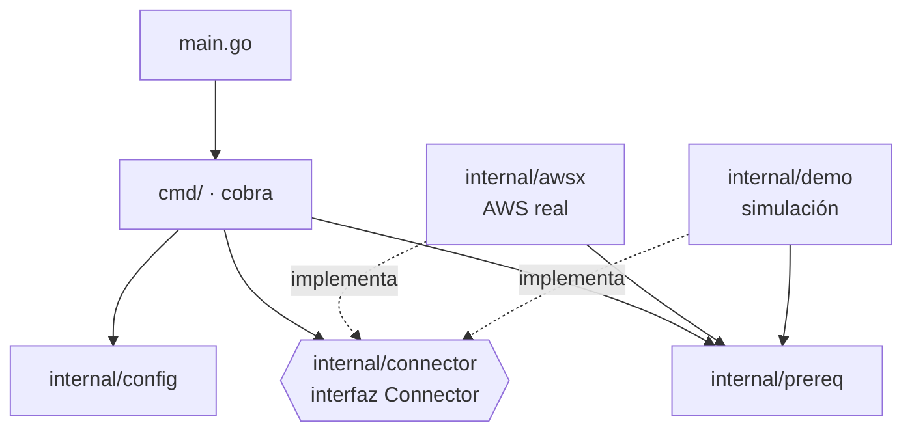
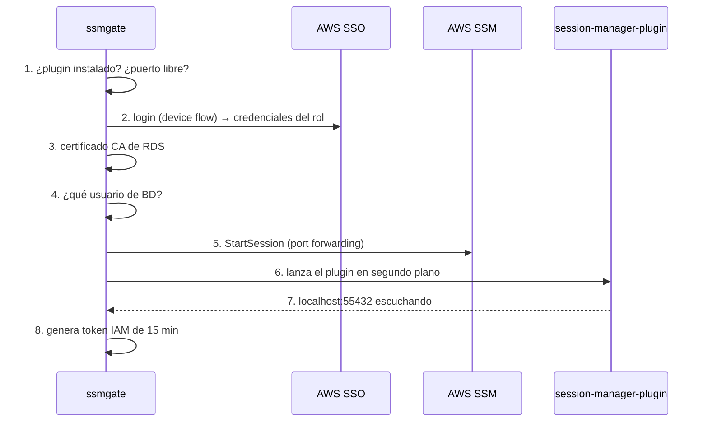

# Cómo está hecho ssmgate: recorrido por el código

Guía para explicar el código en el vídeo y en la defensa del TFM.

**Cómo usarla.** En cada paso tienes:

- 🖥️ **En pantalla**: qué archivo abrir y qué líneas señalar.
- 🎙️ **Qué decir**: un texto que puedes leer o adaptar con tus palabras.
- 💡 **Si te preguntan**: el detalle técnico para responder a fondo.

Los números de línea corresponden a la versión `v1.0.0`.

---

## Índice

1. [La idea en un minuto](#1-la-idea-en-un-minuto)
2. [El mapa del proyecto](#2-el-mapa-del-proyecto)
3. [Seguimos un comando de principio a fin: `ssmgate db --env dev`](#3-seguimos-un-comando-de-principio-a-fin)
4. [El modo demo: la misma interfaz, otra implementación](#4-el-modo-demo)
5. [El comando `tunnel` y la concurrencia](#5-el-comando-tunnel-y-la-concurrencia)
6. [Los tests](#6-los-tests)
7. [CI/CD](#7-cicd)
8. [Conceptos de Go que aparecen (glosario)](#8-conceptos-de-go-que-aparecen)
9. [Seguridad](#9-seguridad)
10. [Preguntas probables del tribunal](#10-preguntas-probables-del-tribunal)
11. [Guion del bloque de código para el vídeo (≈ 6 min)](#11-guion-del-bloque-de-código-para-el-vídeo)

---

## 1. La idea en un minuto

🎙️ **Qué decir:**

> "ssmgate es una herramienta de línea de comandos escrita en Go. Sirve para
> entrar en servidores y bases de datos privadas de AWS **sin SSH y sin abrir
> ningún puerto**. Para ello usa AWS Systems Manager, el servicio de AWS que
> permite abrir sesiones a través de un agente instalado en la instancia.
>
> El código se apoya en tres ideas:
>
> 1. **Toda la infraestructura está en un archivo YAML**, no en el código. Por
>    eso sirve para cualquier empresa.
> 2. **La CLI no habla directamente con AWS.** Habla con una interfaz, el
>    `Connector`, que tiene dos implementaciones: una real que usa AWS y otra
>    de demostración que lo simula.
> 3. **Las dependencias se inyectan.** Eso permite que los tests ejecuten los
>    mismos comandos que usa el usuario, sin red y sin cuenta de AWS."

---

## 2. El mapa del proyecto

🖥️ **En pantalla:** el árbol de carpetas en el editor.

```
main.go                  arranque del programa
cmd/                     CAPA DE PRESENTACIÓN: comandos, flags, salida
internal/config/         MODELO: el YAML, valores por defecto, validación
internal/connector/      CONTRATO: interfaz Connector + tipo Tunnel
internal/awsx/           IMPLEMENTACIÓN REAL (AWS)
internal/demo/           IMPLEMENTACIÓN SIMULADA (sin AWS)
internal/prereq/         utilidades: plugin, psql, puertos, certificado CA
internal/ui/             salida con colores
```

🎙️ **Qué decir:**

> "Está organizado por capas. Arriba está `cmd`, que es lo que ve el usuario:
> los comandos y sus opciones. Debajo está `config`, que es el modelo de datos.
> En el centro está `connector`, que es solo un contrato, una interfaz. Y
> abajo están las dos implementaciones de ese contrato: `awsx`, que habla con
> AWS de verdad, y `demo`, que lo simula.
>
> Las dependencias van siempre hacia abajo: `cmd` conoce la interfaz, pero no
> sabe nada del SDK de AWS. Es inversión de dependencias."

💡 **Si te preguntan por qué todo está en `internal/`:**
En Go, un paquete dentro de `internal/` solo lo puede importar el propio
proyecto. La interfaz pública de ssmgate es la CLI. Lo de dentro se puede
reorganizar sin romper a nadie.



---

## 3. Seguimos un comando de principio a fin

La mejor forma de explicar el código es seguir un comando real, archivo por
archivo, en el orden en que se ejecuta. Usamos `ssmgate db --env dev`.

### Paso 1. El arranque: `main.go`

🖥️ **En pantalla:** [`main.go`](../main.go), líneas 21–37.

```go
func main() { os.Exit(run()) }

func run() int {
    ctx, stop := signal.NotifyContext(context.Background(), os.Interrupt, syscall.SIGTERM)
    defer stop()

    if err := cmd.NewRootCmd(version).ExecuteContext(ctx); err != nil {
        ...
        return 1
    }
    return 0
}
```

🎙️ **Qué decir:**

> "Todo empieza aquí. Lo más importante es esta línea: `signal.NotifyContext`.
> Crea un **contexto** que se cancela cuando el usuario pulsa Ctrl-C. Ese
> contexto se pasa a todo el programa, y así cualquier operación larga (el
> login, la espera del túnel, la shell de la demo) se entera de que tiene que
> parar y libera sus recursos.
>
> La variable `version` vale `"dev"`, pero al compilar la release se
> sustituye por el número de versión real con un flag del compilador."

💡 **Si te preguntan por qué `main` llama a `run()`:**
`os.Exit` termina el programa sin ejecutar los `defer` pendientes. Separando
la lógica en `run()`, el `defer stop()` se ejecuta siempre antes de salir. Lo
detectó el linter (`gocritic: exitAfterDefer`).

---

### Paso 2. La CLI y la inyección de dependencias: `cmd/root.go`

🖥️ **En pantalla:** [`cmd/root.go`](../cmd/root.go), la struct `app` (línea 24).

```go
type app struct {
    configPath string
    demo       bool
    envName    string
    yes        bool

    in           io.Reader
    newConnector func(cfg *config.File) connector.Connector
    clipboard    func(text string) string
}
```

🎙️ **Qué decir:**

> "Para los comandos uso la librería **cobra**, que es el estándar en Go:
> la usan herramientas como `kubectl` o el CLI de GitHub.
>
> Una decisión importante: **no hay variables globales**. Todo lo que un
> comando necesita está en esta struct `app`: los flags del usuario y tres
> dependencias externas. Esas dependencias son de dónde se lee la entrada del
> teclado, qué conector se usa y cómo se copia al portapapeles.
>
> En producción se rellenan con lo real: el teclado, el portapapeles del
> sistema y el conector de AWS. En los tests se sustituyen por un texto
> predefinido, un portapapeles falso y el conector demo. Es **inyección de
> dependencias**, sin ningún framework."

🖥️ **En pantalla:** el método `connector()` (línea 107).

```go
func (a *app) connector(cfg *config.File) connector.Connector {
    if a.newConnector != nil {   // los tests inyectan el suyo
        return a.newConnector(cfg)
    }
    if a.demo {                  // --demo
        return demo.New()
    }
    return awsx.New(cfg.SSO)     // uso real
}
```

🎙️ **Qué decir:**

> "Aquí se decide qué implementación se usa. Fíjate en que el método devuelve
> el tipo `connector.Connector`, la interfaz. A partir de este punto, el resto
> del código no sabe si está hablando con AWS o con la simulación."

🖥️ **En pantalla:** el método `setup()` (línea 119).

🎙️ **Qué decir:**

> "`setup` es el flujo común de todos los comandos que actúan sobre un
> entorno. Hace tres cosas: carga la configuración, comprueba que el entorno
> pasado con `--env` existe y, si el entorno está marcado como protegido,
> pide al usuario que escriba su nombre antes de continuar. Esto evita, por
> ejemplo, lanzar algo contra producción por error."

💡 **Si te preguntan por `readLine` (línea 151):**
La confirmación lee el teclado **byte a byte**. Al principio usaba un lector
con buffer, que leía de más y se quedaba líneas que eran para la shell o para
psql. Fue un bug real, detectado en pruebas manuales y cubierto con el test
`TestReadLineLeavesRestOfInput`.

---

### Paso 3. La configuración: `internal/config/config.go`

🖥️ **En pantalla:** primero el YAML de ejemplo,
[`internal/config/example.yaml`](../internal/config/example.yaml), y después
las structs de [`config.go`](../internal/config/config.go) (líneas 49–112).

🎙️ **Qué decir:**

> "El archivo YAML se convierte en estas structs de Go: `File`, que contiene
> varios `Environment`, y cada entorno tiene sus `Host` y su `Database`. Las
> etiquetas `yaml:"..."` indican qué clave del YAML corresponde a cada campo."

🖥️ **En pantalla:** la función `Parse` (línea 185).

```go
func Parse(b []byte) (*File, error) {
    var f File
    dec := yaml.NewDecoder(strings.NewReader(string(b)))
    dec.KnownFields(true)   // una clave mal escrita es un error
    if err := dec.Decode(&f); err != nil { ... }
    f.applyDefaults()
    if err := f.Validate(); err != nil { ... }
    return &f, nil
}
```

🎙️ **Qué decir:**

> "Cargar la configuración tiene tres fases:
>
> 1. **Leer de forma estricta.** Con `KnownFields(true)`, si alguien escribe
>    `regoin` en vez de `region`, no se ignora en silencio: es un error. Es
>    un fallo muy común en archivos de configuración y aquí se detecta.
> 2. **Aplicar valores por defecto**: puerto 5432, autenticación IAM y
>    `sslmode verify-ca`.
> 3. **Validar todo.**"

🖥️ **En pantalla:** `Validate()` (línea 230) y el `errors.Join` final (línea 315).

🎙️ **Qué decir:**

> "La validación comprueba que los IDs de cuenta tienen 12 dígitos, que los
> IDs de instancia tienen el formato correcto, que el host por el que pasa el
> túnel existe y que dos entornos no usan el mismo puerto local. Y lo más
> importante: **no se para en el primer error**. Los acumula todos y los
> devuelve juntos con `errors.Join`, así el usuario arregla su archivo de una
> vez en lugar de ir error por error.
>
> El principio es **fallar pronto y con un mensaje claro**: una configuración
> inválida nunca llega a tocar AWS."

🖥️ **En pantalla:** la línea `//go:embed example.yaml` (línea 25).

🎙️ **Qué decir:**

> "El YAML de ejemplo va **dentro del binario** gracias a `go:embed`. El mismo
> archivo sirve para tres cosas: la plantilla de `ssmgate config init`, la
> configuración del modo demo y un test que comprueba que el ejemplo siempre es
> válido. Es una única fuente de verdad."

---

### Paso 4. El comando `db`: `cmd/db.go`

🖥️ **En pantalla:** [`cmd/db.go`](../cmd/db.go), líneas 34–65.

```go
conn := a.connector(cfg)
runner, simulated := conn.(psqlRunner)
if !simulated {
    if err := prereq.CheckPsql(); err != nil { return err }
}
t, err := conn.OpenTunnel(c.Context(), env)
if err != nil { return err }
defer t.Close()

if simulated {
    return runner.Psql(c.Context(), env, t)
}
return runPsql(env.DB, t)
```

🎙️ **Qué decir:**

> "El comando `db` es muy corto porque el trabajo pesado lo hace el conector.
> Tres detalles:
>
> 1. **Comprueba que `psql` existe antes de hacer login.** Sería frustrante
>    autenticarse en AWS para luego descubrir que falta el cliente.
> 2. **`defer t.Close()`**: pase lo que pase (error, salida normal o Ctrl-C),
>    el túnel se cierra al terminar la función. Es la forma idiomática de Go de
>    gestionar recursos, como cerrar un archivo.
> 3. **`conn.(psqlRunner)`** es una comprobación de tipo: pregunta si el
>    conector, además, sabe ejecutar su propio psql. El de demo sí, porque lo
>    simula. El de AWS no, así que se lanza el `psql` real."

---

### Paso 5. El contrato: `internal/connector/connector.go`

🖥️ **En pantalla:** [`connector.go`](../internal/connector/connector.go), líneas 15–60.

```go
type Connector interface {
    Shell(ctx context.Context, env *config.Environment, host string) error
    OpenTunnel(ctx context.Context, env *config.Environment) (*Tunnel, error)
}
```

🎙️ **Qué decir:**

> "Esta es la pieza central del diseño. La interfaz tiene solo dos métodos:
> abrir una shell y abrir un túnel. Cualquier tipo que tenga esos dos métodos
> **es** un Connector. En Go las interfaces se cumplen implícitamente, sin
> declarar `implements`.
>
> Es el **patrón Strategy**: la CLI elige una estrategia (AWS o demo) y usa
> siempre la misma interfaz."

🖥️ **En pantalla:** el tipo `Tunnel` y sus métodos `Done`, `MarkDone` y `Close`.

🎙️ **Qué decir:**

> "`Tunnel` representa un túnel abierto. Guarda el puerto local, el usuario,
> la contraseña temporal y el certificado. Además tiene dos mecanismos de
> sincronización:
>
> - **`Done()`** devuelve un canal que se cierra cuando el túnel deja de
>   funcionar. Así otra parte del programa puede esperar a ese evento.
> - **`Close()`** usa `sync.Once` para que el cierre ocurra **una sola vez**,
>   aunque se llame desde varios sitios a la vez. Es idempotente y seguro con
>   concurrencia, y hay un test que lo llama desde 10 goroutines a la vez."

---

### Paso 6. La implementación real: `internal/awsx/`

Este es el bloque más técnico. 🖥️ Abre
[`internal/awsx/connector.go`](../internal/awsx/connector.go), `OpenTunnel`
(línea 89), y recórrelo paso a paso:



#### 6.1 Comprobaciones previas

🎙️ **Qué decir:**

> "Antes de nada se comprueba que el `session-manager-plugin` está instalado y
> que el puerto local está libre. Otra vez: fallar pronto."

💡 **Si te preguntan cómo se comprueba el puerto**
([`prereq.go`](../internal/prereq/prereq.go), línea 105):
Se intenta **ocupar** el puerto con `net.Listen`. Si se puede, está libre; si
no, alguien lo usa. Al principio se intentaba **conectar** a él, pero en
Windows conectar a un puerto cerrado puede tardar 2 segundos, y eso rompió el
CI de Windows. Fue un fallo real que se corrigió.

#### 6.2 Credenciales: SSO o perfil (`awsConfig`, línea 37)

🎙️ **Qué decir:**

> "Cada entorno puede autenticarse de dos formas. Si el entorno tiene un
> `profile`, se usa un perfil existente de la AWS CLI. Si no, se usa el login
> SSO integrado: IAM Identity Center, el sistema de inicio de sesión único de
> AWS que usan las empresas."

🖥️ **En pantalla:** [`sso.go`](../internal/awsx/sso.go), `Login` (línea 55).

🎙️ **Qué decir:**

> "El login SSO usa el flujo **OAuth device authorization**, el mismo que usas
> para iniciar sesión en una Smart TV:
>
> 1. Primero mira si hay un **token guardado** y válido. Si lo hay, no pide
>    nada.
> 2. Si no, se registra como cliente y pide un **código de dispositivo**.
> 3. Muestra al usuario una URL y un código, y además intenta abrir el
>    navegador.
> 4. Mientras el usuario aprueba en el navegador, el programa **consulta
>    periódicamente** si ya hay token.
>
> La ventaja es que funciona sin navegador local: desde WSL, por SSH o en un
> servidor remoto basta con abrir la URL en el móvil."

💡 **Detalles para preguntas:**
- `pollForToken` (línea 122) respeta el intervalo que indica AWS y, si AWS
  responde `SlowDown`, espera 5 segundos más. Además escucha el contexto, así
  que Ctrl-C lo interrumpe.
- La caché (`ssoCachePath`, línea 189) usa la **misma ruta y el mismo formato
  que la AWS CLI** (`~/.aws/sso/cache/<sha1 de la URL>.json`): un login hecho
  con `aws sso login` se reutiliza, y al revés también. El archivo se escribe
  con permisos `0600`, legible solo por el usuario.
- Un token se descarta si le quedan menos de 2 minutos de validez, para que
  no caduque a mitad de la operación.
- `RoleCredentials` (línea 164) cambia el token SSO por **credenciales
  temporales** del rol concreto (`GetRoleCredentials`).

#### 6.3 Certificado CA (`ensureCA`, línea 147)

🎙️ **Qué decir:**

> "Para conectar a la base de datos con SSL verificado hace falta el
> certificado raíz de AWS RDS. Si no está, se descarga automáticamente."

💡 **Detalle:** la descarga se escribe primero en un archivo `.part` y solo al
terminar se renombra (`os.Rename`). Si se corta a mitad, nunca queda un
certificado incompleto que se daría por bueno en el siguiente arranque.

#### 6.4 Usuario de base de datos (`rds.go`, `resolveDBUser` línea 36)

🎙️ **Qué decir:**

> "¿Con qué usuario se entra en Postgres? Por orden de prioridad: la variable
> de entorno `SSMGATE_DB_USER`, después el campo `user` del YAML y, si no hay
> ninguno, se deduce de la identidad de AWS.
>
> Aquí hay un detalle del mundo real: con SSO, tu identidad en AWS suele ser
> tu email, `ana@empresa.com`, pero el usuario de Postgres suele ser solo
> `ana`. La función `UserFromARN` corta por la arroba."

#### 6.5 El túnel (`session.go`)

🖥️ **En pantalla:** [`session.go`](../internal/awsx/session.go),
`startPortForward` (línea 43) y `pluginArgs` (línea 76).

🎙️ **Qué decir:**

> "Aquí hay una decisión de arquitectura importante. El SDK de AWS solo
> implementa **la mitad** de una sesión SSM: la llamada `StartSession` devuelve
> una URL y un token, pero el protocolo para enviar los datos por ese canal
> (un websocket con su propio formato) no está en el SDK. Lo implementa el
> **`session-manager-plugin`**, el programa oficial y open source de AWS.
>
> Así que ssmgate hace la llamada con el SDK y luego lanza el plugin pasándole
> los argumentos con **exactamente el mismo formato que usa la AWS CLI**. Eso
> está aislado en la función `pluginArgs`, que además tiene tests. Si algún
> día se integra el plugin dentro del binario, solo cambia este archivo."

#### 6.6 Esperar a que el túnel esté listo (`connector.go`, líneas 125–131 y 167)

```go
t = connector.NewTunnel(func() { stopProcess(proc, t.Done()) })
go func() { _ = proc.Wait(); t.MarkDone() }()

if err := waitForPort(t, db.LocalPort, TunnelTimeout); err != nil { ... }
```

🎙️ **Qué decir:**

> "El plugin se lanza en segundo plano. Una **goroutine**, que es un hilo
> ligero de Go, se queda esperando a que el proceso termine; cuando termina,
> marca el túnel como muerto.
>
> Mientras tanto, `waitForPort` espera con un `select` a la primera de tres
> cosas: que el puerto local empiece a escuchar (éxito), que el plugin muera
> (error con mensaje claro) o que pasen 30 segundos (timeout)."

💡 **`stopProcess` (línea 188):** primero pide al plugin que termine con
SIGTERM; si en 3 segundos no ha terminado, lo mata. En Windows no existe
SIGTERM, así que se mata directamente.

#### 6.7 El token IAM (`buildAuthToken`, rds.go línea 61)

🎙️ **Qué decir:**

> "Por último se genera un **token IAM de RDS**: una contraseña temporal,
> firmada criptográficamente con las credenciales del rol y válida 15 minutos.
> No hay contraseñas guardadas en ningún sitio.
>
> Detalle importante: aunque conectemos a `localhost`, el token se firma para
> el **nombre real** de la base de datos, porque RDS comprueba la firma contra
> su propio nombre."

---

### Paso 7. Vuelta a `cmd/db.go`: lanzar `psql`

🖥️ **En pantalla:** `PsqlConnString` (línea 74) y `runPsql` (línea 101).

🎙️ **Qué decir:**

> "Con el túnel abierto, se construye la cadena de conexión de Postgres y se
> lanza `psql`. Dos detalles:
>
> - **El token va en la variable de entorno `PGPASSWORD`**, no en la línea de
>   comandos. Así no aparece en la lista de procesos del sistema.
> - **`sslmode=verify-ca` y no `verify-full`.** Por el túnel conectamos a
>   `127.0.0.1`, y `verify-full` comprobaría que el certificado corresponde a
>   ese nombre, cosa que fallaría. `verify-ca` sigue verificando que el
>   certificado lo firmó la autoridad de AWS, que es lo que importa.
>
> Cuando el usuario sale de `psql`, se ejecuta el `defer t.Close()` del paso 4
> y el túnel se cierra."

💡 **`quoteConnValue` (línea 92):** si un valor tiene espacios (por ejemplo una
ruta de Windows), se escribe entre comillas y se escapan las barras invertidas
según las reglas de libpq. Tiene su propio test.

---

## 4. El modo demo

🖥️ **En pantalla:** [`internal/demo/demo.go`](../internal/demo/demo.go).

🎙️ **Qué decir:**

> "El modo demo es la otra implementación de la misma interfaz. Recorre los
> mismos pasos que la real (login, rol, túnel, token), pero sin hacer ninguna
> llamada a AWS.
>
> Lo interesante es que **no es todo de mentira**. En la línea 98, el túnel de
> la demo abre un **puerto TCP real** con `net.Listen`. Así las comprobaciones
> de puertos funcionan igual, y si apuntas un cliente a ese puerto recibe un
> mensaje explicando que es una demo."

🖥️ **En pantalla:** la función `repl` (línea 160).

```go
lines := make(chan string)
go func() {                         // goroutine que lee el teclado
    sc := bufio.NewScanner(in)
    for sc.Scan() { lines <- sc.Text() }
}()
for {
    select {
    case <-ctx.Done():              // Ctrl-C
        return nil
    case line, ok := <-lines:       // el usuario escribió algo
        ...
    }
}
```

🎙️ **Qué decir:**

> "La shell y el psql simulados son un bucle de leer, responder y repetir.
> Leer del teclado es una operación que bloquea, así que se hace en una
> goroutine aparte que envía cada línea por un **canal**. El bucle principal
> espera con `select` a lo primero que ocurra: una línea nueva o la
> cancelación del contexto. Es el patrón típico de Go para combinar una
> entrada bloqueante con la cancelación."

💡 **¿Por qué hay pausas en la demo?** El campo `Step` mete 350 ms entre pasos
para que en el vídeo se pueda seguir lo que pasa. En los tests vale 0.

---

## 5. El comando `tunnel` y la concurrencia

🖥️ **En pantalla:** [`cmd/tunnel.go`](../cmd/tunnel.go), líneas 46–53.

```go
select {
case <-c.Context().Done():   // el usuario pulsó Ctrl-C
case <-t.Done():             // el túnel murió solo
    return ui.Errorf("the tunnel closed unexpectedly")
}
```

🎙️ **Qué decir:**

> "`tunnel` abre el mismo túnel, imprime los datos de conexión, copia el
> token al portapapeles y se queda esperando. ¿A qué? A una de dos cosas: que
> el usuario pulse Ctrl-C o que el túnel se caiga solo, por ejemplo por un
> problema de red. Este `select` une los dos mecanismos que vimos: el contexto
> de `main.go` y el canal `Done` del `Tunnel`."

💡 **Portapapeles:** `copyToClipboard` (línea 108) prueba, por orden,
`clip.exe` (Windows y WSL), `pbcopy` (macOS), `wl-copy` (Wayland) y `xclip`
(X11). Si no encuentra ninguno, avisa de que hay que copiarlo a mano.

---

## 6. Los tests

🖥️ **En pantalla:** [`cmd/cmd_test.go`](../cmd/cmd_test.go), la función `run` (línea 23).

```go
a := &app{
    in:        in,
    clipboard: func(string) string { return "clipboard disabled in tests" },
    newConnector: func(*config.File) connector.Connector {
        return &demo.Connector{In: in, Out: &out}
    },
}
root := newRootCmd("test", a)
root.SetArgs(args)
err := root.ExecuteContext(ctx)
```

🎙️ **Qué decir:**

> "Aquí se ve por qué la inyección de dependencias merece la pena. Este helper
> construye **el árbol de comandos real**, el mismo que usa el usuario, pero
> le inyecta un teclado simulado, un portapapeles falso y el conector demo.
> Con eso un test ejecuta `ssmgate shell` o `ssmgate db` de principio a fin,
> sin red."

🖥️ **En pantalla:** `TestProtectedEnvironmentConfirmation` (línea 89).

🎙️ **Qué decir:**

> "Por ejemplo, este test comprueba la protección de producción en cuatro
> casos: si escribes un nombre equivocado se aborta, si no escribes nada se
> aborta y sugiere `--yes`, si escribes `prod` continúa, y con `--yes` no
> pregunta."

**Qué cubren los 38 tests:**

| Paquete | Qué se prueba |
|---|---|
| `cmd` | Comandos completos con el conector demo: `envs`, `shell`, `db`, `tunnel`, `config init/validate`, `--env` obligatorio, host desconocido, confirmación de prod, cadena de conexión libpq |
| `config` | El ejemplo es válido, valores por defecto, validación con todos los errores a la vez, claves desconocidas, puertos duplicados, entornos con perfil |
| `awsx` | `UserFromARN`, argumentos del plugin (shell y port forwarding), caché SSO (válido, caducado, corrupto, por URL), nombre del archivo compatible con la AWS CLI |
| `demo` | El túnel abre y cierra un puerto real, puerto ocupado, autenticación por contraseña, shell y psql simulados, cancelación |
| `connector` | `Close` idempotente con 10 goroutines a la vez, `MarkDone` repetido |
| `prereq` | Descarga del certificado con un servidor HTTP falso (`httptest`), error HTTP sin dejar archivos, puertos, herramientas ausentes |

💡 **Si te preguntan por la cobertura de `awsx`:** es baja porque esa parte son
llamadas de red a AWS. Lo que se puede probar sin red (parseo, argumentos,
caché) está cubierto. El resto del flujo comparte el contrato con el conector
demo, que sí está probado de punta a punta. El siguiente paso sería simular
los clientes del SDK con interfaces.

---

## 7. CI/CD

🖥️ **En pantalla:** [`.github/workflows/ci.yml`](../.github/workflows/ci.yml)
y la pestaña Actions de GitHub.

🎙️ **Qué decir:**

> "Cada push ejecuta en GitHub Actions:
>
> 1. **golangci-lint**, un linter que agrupa decenas de analizadores
>    (staticcheck, gocritic, errorlint…).
> 2. **Los tests en Linux, Windows y macOS**, con el detector de condiciones
>    de carrera de Go activado (`-race`).
> 3. **Una prueba rápida del modo demo** con el binario compilado.
> 4. **Compilación cruzada** para las 6 plataformas.
>
> Y cuando creo un tag como `v1.0.0`, otro workflow ejecuta **GoReleaser**,
> que compila, empaqueta y publica los binarios en GitHub Releases. Eso es el
> despliegue de una herramienta de línea de comandos."

💡 **Anécdota que puedes contar:** el primer CI falló solo en Windows por el
tiempo de conexión a puertos cerrados (paso 6.1). Tener los tests en los tres
sistemas detectó un fallo que en mi máquina no aparecía.

---

## 8. Conceptos de Go que aparecen

Por si te piden explicar alguno:

| Concepto | Qué es | Dónde aparece |
|---|---|---|
| **Interfaz implícita** | Un tipo cumple una interfaz solo con tener sus métodos, sin declararlo | `Connector` |
| **Goroutine** | Función que se ejecuta concurrentemente; es muy ligera (miles a la vez) | Espera del plugin, lectura del teclado en la demo |
| **Canal (`chan`)** | Tubería para comunicar goroutines de forma segura | `Tunnel.Done()`, `lines` en `repl` |
| **`select`** | Espera a la primera de varias operaciones con canales | `waitForPort`, `tunnel`, `repl` |
| **`context.Context`** | Señal de cancelación que se propaga por todo el programa | Desde `main.go` a todas las funciones |
| **`defer`** | Ejecuta algo al salir de la función, pase lo que pase | `defer t.Close()` |
| **`sync.Once`** | Garantiza que algo se ejecuta una sola vez, aunque sea concurrente | `Tunnel.Close`, `Tunnel.MarkDone` |
| **Comprobación de tipo** | `x.(T)` pregunta si un valor implementa otro tipo | `conn.(psqlRunner)` |
| **`go:embed`** | Incrusta un archivo dentro del binario al compilar | `example.yaml` |
| **`internal/`** | Paquetes que solo puede importar el propio módulo | Todo menos `cmd` y `main` |
| **`errors.Join`** | Combina varios errores en uno | `Validate()` |

---

## 9. Seguridad

🎙️ **Qué decir (si sale el tema):**

> "La seguridad es el motivo de existir de la herramienta:
>
> - **Ningún puerto de entrada**: el agente SSM sale hacia AWS, nadie entra.
> - **Ninguna credencial permanente**: credenciales de rol temporales y token
>   de base de datos de 15 minutos.
> - **Mínimo privilegio**: cada host puede exigir un rol distinto.
> - **Trazabilidad**: cada sesión queda ligada a la identidad SSO de la
>   persona y registrada en AWS.
> - **Producción protegida**: `--env` obligatorio y confirmación escrita.
> - **Archivos sensibles con permisos `0600`**: la caché SSO y la
>   configuración.
> - **El token no aparece en la lista de procesos**: va por variable de
>   entorno, no como argumento.
> - **SSL verificado contra la CA de AWS** (`verify-ca`)."

---

## 10. Preguntas probables del tribunal

**¿Por qué Go y no Python o bash?**
Un único binario estático sin dependencias: el usuario no instala un intérprete
ni librerías. Además, compilar para 6 plataformas es trivial, el SDK oficial de
AWS es de primera clase y la concurrencia (goroutines, canales) encaja con
túneles y procesos en segundo plano.

**¿Por qué no reimplementar el protocolo SSM en vez de usar el plugin?**
El protocolo del canal de datos es complejo (websocket con mensajes binarios
propios, confirmaciones, cifrado opcional con KMS) y AWS ya lo mantiene en el
plugin oficial. Reimplementarlo sería frágil. Está aislado en un archivo
(`session.go`), así que se podría cambiar más adelante.

**¿Qué pasa si se cae la red con el túnel abierto?**
El plugin termina, la goroutine que lo espera cierra el canal `Done` y el
comando `tunnel` sale con el error "the tunnel closed unexpectedly". No se
queda colgado.

**¿Cómo añadirías otro proveedor (por ejemplo, Azure Bastion)?**
Con otra implementación de `Connector` y quizá algún campo nuevo en el YAML.
`cmd` apenas cambiaría: es justo para lo que está la interfaz.

**¿Cómo garantizas que funciona sin tener AWS en los tests?**
Por el contrato: los tests ejecutan los comandos reales con el conector demo,
y las partes de AWS que se pueden aislar (argumentos del plugin, ARN, caché)
tienen tests unitarios propios.

**¿Qué hizo la IA y qué hiciste tú?**
Ver [DESARROLLO_IA.md](DESARROLLO_IA.md). Idea clave: la IA escribió gran
parte del código y de los tests, pero las decisiones de diseño (interfaz,
config genérica, modo demo), la revisión y la verificación (lint, tests,
pruebas manuales, CI en 3 sistemas) fueron mías. Y hubo bugs reales que se
detectaron y corrigieron en el proceso.

**¿Qué mejorarías?**
Integrar el plugin en el binario, soportar MySQL, distribuir por Homebrew y
Scoop, descubrir instancias por etiquetas de AWS en vez de por ID y subir la
cobertura de `awsx` simulando los clientes del SDK.

---

## 11. Guion del bloque de código para el vídeo

Unos 6 minutos. Sustituye al bloque "Código" de [GUION_VIDEO.md](GUION_VIDEO.md).

| Tiempo | Pantalla | Mensaje clave |
|---|---|---|
| 0:00 | Árbol de carpetas | "Organizado por capas: comandos, modelo, contrato e implementaciones." (sección 2) |
| 0:40 | `connector.go` | "La pieza central: una interfaz con dos métodos y dos implementaciones." (paso 5) |
| 1:30 | `root.go`: `app` y `connector()` | "Sin globales: dependencias inyectadas. Aquí se elige AWS o demo." (paso 2) |
| 2:20 | `config.go`: `Parse` y `Validate` | "Lectura estricta, valores por defecto y todos los errores a la vez." (paso 3) |
| 3:10 | `awsx/connector.go`: `OpenTunnel` | Recorre los 8 pasos del diagrama. Para un momento en SSO (device flow) y en el plugin. (paso 6) |
| 4:30 | `db.go`: `PGPASSWORD` y `verify-ca` | "El token no aparece en la lista de procesos; SSL verificado a través del túnel." (paso 7) |
| 5:00 | `cmd_test.go`: `run()` | "Los tests ejecutan el árbol de comandos real con el conector demo." (sección 6) |
| 5:40 | GitHub Actions | "Lint y tests en 3 sistemas; el CI de Windows detectó un bug real." (sección 7) |

**Consejos para grabar:**
- Aumenta el tamaño de letra del editor (18–20 pt) y oculta paneles que no uses.
- Usa "Ir a línea" (Ctrl+G) para saltar directamente a cada punto de esta guía.
- No leas el código línea a línea: señala la parte clave y explica **por qué**
  está hecha así. El "por qué" es lo que demuestra que entiendes el código.
